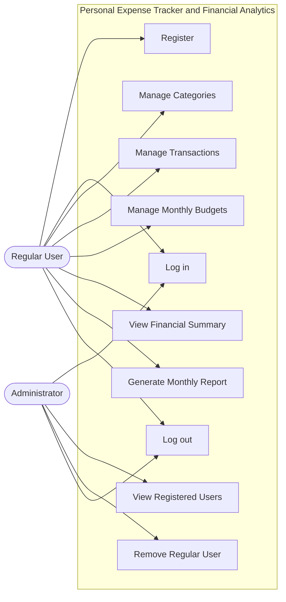
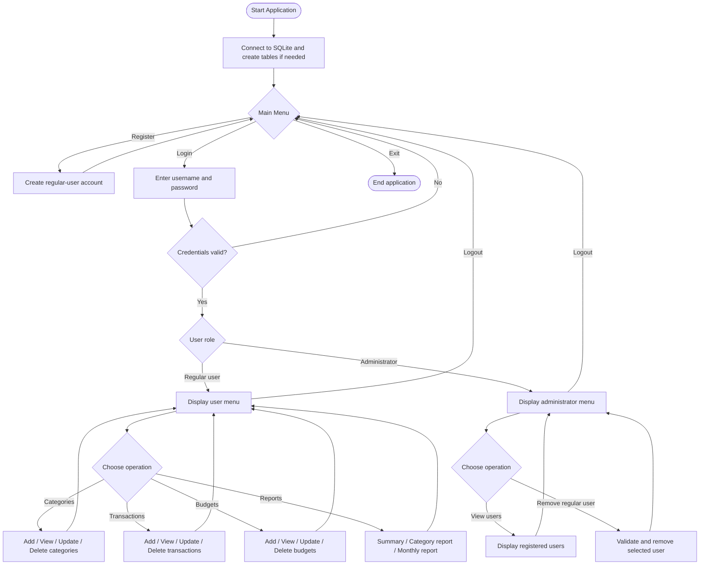

# Personal Expense Tracker & Financial Analytics

**Prepared by:** SELMA INTHISAN  
**Project type:** Python + SQLite Database Management System  
**Interface:** Command-line menu  
**Database file:** `expense_tracker.db`

## 1. Project overview

The Personal Expense Tracker & Financial Analytics system is a menu-driven Python application for recording personal income and expenses. It stores records in SQLite and uses them to calculate financial summaries, category-wise spending, monthly reports, and budget status.

I selected this project because tracking income, expenses, and budgets is a practical everyday problem. The project applies Python and database concepts to organize financial records and make spending easier to understand.

### Main objectives
- Record income and expense transactions.
- Organize transactions into categories.
- Set monthly budgets for categories.
- Calculate total income, expenses, and savings/balance.
- Identify the highest-spending category.
- Compare category spending with its monthly budget.
- Demonstrate Python, SQL, CRUD, authentication, validation, and relational database concepts.

## 2. Actors and permissions

### Regular user
A regular user can register, log in, manage their own categories, transactions, and budgets, view financial reports, and log out.

### Administrator
The administrator logs in with an account assigned the `admin` role. In the current project design, administrative actions include viewing registered users and removing unauthorized regular-user accounts, if enabled in the administrator menu. The administrator should not be described as having permission to edit every user's transactions unless that feature exists in the submitted code.

## 3. Main modules

| Module | Purpose |
|---|---|
| Authentication | Registration and login |
| Category management | Add, view, update, and delete income/expense categories |
| Transaction management | Add, view, update, and delete financial transactions |
| Budget management | Create, view, update, and delete monthly category budgets |
| Financial analytics | Calculate income, expenses, balance, and category spending |
| Monthly report | Show monthly totals, highest-spending category, and budget status |
| Administrator module | Perform the implemented user-administration actions |

## 4. Database design

The program uses Python's built-in `sqlite3` module. SQLite stores the database in a local file and does not require a separate database server.

| Table | Purpose and main fields |
|---|---|
| `Users` | `user_id` (PK), `username`, `password`, `role` |
| `Categories` | `category_id` (PK), `user_id` (FK), `category_name`, `category_type` |
| `Transactions` | `transaction_id` (PK), `user_id` (FK), `category_id` (FK), `amount`, `transaction_type`, `description`, `date` |
| `Budgets` | `budget_id` (PK), `user_id` (FK), `category_id` (FK), `amount_limit`, `month` |

**PK** means Primary Key, a unique identifier for a row. **FK** means Foreign Key, a field that refers to a row in another table.

### Relationships
- One user can have many categories.
- One user can have many transactions.
- One category can be used by many transactions.
- One user can have many budgets.
- Each budget is linked to a category.
- The application should ensure that a transaction's category belongs to the logged-in user.

Relationship overview:
- Users → Categories → Transactions
- Users → Transactions
- Users → Budgets ← Categories

## 5. Typical user workflow

1. Start the application.
2. Register or log in.
3. Open the menu for the logged-in role.
4. Create income and expense categories.
5. Add transactions with category, amount, type, description, and date.
6. View, update, or delete transactions as needed.
7. Set a monthly budget for an expense category.
8. View the financial summary, category report, or monthly report.
9. Log out.

### Example calculation
If recorded income is ₹30,000 and recorded expenses are ₹200:

`Savings / Balance = Total Income - Total Expenses`

`₹30,000 - ₹200 = ₹29,800`

This is the difference between recorded income and expenses, not a bank-account balance.

## 6. Monthly report

Enter the month in `YYYY-MM` format, for example `2026-10`.

| Report item | Meaning |
|---|---|
| Total income | Sum of income transactions for the selected month |
| Total expenses | Sum of expense transactions for the selected month |
| Savings/balance | Monthly income minus monthly expenses |
| Highest-spending category | Expense category with the largest total for that month |
| Within Budget | Spending is lower than the budget limit |
| Budget Reached | Spending exactly equals the budget limit |
| Budget Exceeded | Spending is greater than the budget limit |

Budget status is available only for categories with a budget set for the selected month.

## 7. Project files

The exact files may vary with the current version of the project.

| File | Responsibility |
|---|---|
| `main.py` | Starts the program and displays menus |
| `database.py` | Creates tables and provides database connections |
| `auth.py` | Registration and login |
| `categories.py` | Category CRUD operations |
| `transactions.py` | Transaction CRUD operations |
| `budgets.py` | Budget CRUD operations |
| `reports.py` | Summary, monthly report, and category report |
| `make_admin.py` | Optional utility for assigning an administrator role |
| `expense_tracker.db` | SQLite database and saved records |
| `README.md` | Project documentation and setup instructions |

Helper scripts such as `view_database.py` or `check_users.py`, if present, are used to inspect data and are not necessarily needed to run the main application.

## 8. Requirements

- Python 3.11 or a compatible Python 3 version.
- Python's `sqlite3` module (normally included with Python).
- VS Code or another Python editor is recommended.

## 9. Setup and run

1. Open the project folder in VS Code.
2. Open **Terminal → New Terminal** and make sure the terminal is in the folder containing `main.py`.
3. Optionally create a virtual environment:

   ```powershell
   python -m venv venv
   ```

4. Activate it in Windows PowerShell:

   ```powershell
   .\venv\Scripts\Activate.ps1
   ```

   If activation is blocked, run the environment's Python directly:

   ```powershell
   .\venv\Scripts\python.exe main.py
   ```

5. Start the application:

   ```powershell
   python main.py
   ```

6. Register an account if needed, then log in and use the menus.

The application should create the tables during startup. SQLite creates the database file when a connection opens if the file does not already exist.

### Administrator setup
New registrations should receive the regular `user` role. If `make_admin.py` is part of your project, use it only when you intentionally want to assign the administrator role to a trusted account. Ordinary users should not be able to select the `admin` role during registration.

## 10. Testing checklist

Keep a backup of `expense_tracker.db` before testing delete operations.

### Authentication
- Register a new account.
- Try registering the same username twice.
- Test correct and incorrect login details.
- Log out and check that the program returns to the main menu.

### Categories
- Add an income category such as `Salary` and an expense category such as `Food`.
- View, update, and delete a test category.
- Check what happens when a category is already used by a transaction or budget.

### Transactions
- Add income and expense transactions.
- View, update, and delete a test transaction.
- Try an invalid category ID, text instead of an amount, zero, a negative amount, an invalid transaction type, and an incorrectly formatted date.

### Budgets and reports
- Add a budget for a category and month.
- View, update, and delete a test budget.
- Test duplicate budgets for the same user, category, and month.
- Test spending below, equal to, and above a budget limit.
- Verify income, expenses, savings, and the highest-spending category against the stored test data.
- Check behavior when no transactions or budgets exist.

### Roles
- Confirm a regular user cannot access the administrator menu.
- Test user removal only with a disposable regular-user account.

## 11. Python and DBMS concepts

The project can demonstrate:
- Variables and data types: IDs, amounts, dates, strings, and roles.
- Functions: separate functions for authentication, categories, transactions, budgets, and reports.
- Conditional statements: menu choices, validation, and budget status.
- Loops: repeat menus until the user exits.
- Lists and tuples: store rows returned by SQLite queries.
- Dictionaries: map transaction types to totals in reports.
- SQL queries: `CREATE TABLE`, `INSERT`, `SELECT`, `UPDATE`, `DELETE`, `JOIN`, `SUM`, and `GROUP BY`, where used.
- CRUD: Create, Read, Update, and Delete operations.
- Authentication and role-based menu access.
- Exception handling with `try`, `except`, and `finally`.
- Primary and foreign keys and input validation.

**Lists, tuples, dictionaries, and sets:** only claim set usage if a `set` is actually used in the submitted source code. OOP is optional for this assignment.

## 12. Design considerations

- This is a local command-line educational project, not an online banking service.
- Reports depend on the accuracy of the records entered.
- The database path should be consistent so the program does not accidentally open a second, empty database.
- Foreign-key enforcement must be enabled on every SQLite connection. The connection helper uses `PRAGMA foreign_keys = ON`.
- If passwords are stored using a simple SHA-256 hash, that is not recommended for production password storage. Password-specific hashing such as PBKDF2 or bcrypt is stronger.
- Test account and category deletion carefully when related records exist.

## 13. Use-case diagram

This is a high-level view of the intended interactions. Keep it consistent with the functions implemented in the final code.



## 14. System-flow diagram



